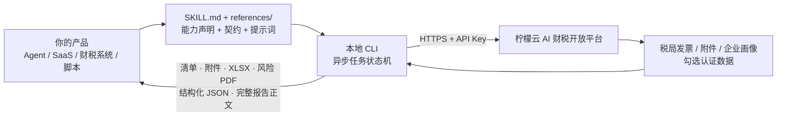

# invoice-fetch-and-risk-analysis · 柠檬云发票获取及风险分析 Skill

> **给开发者**：把「按企业与期间拉取全量发票及电子附件 → 归集存档 → 六大维度统计 → 结合纳税人身份与行业扫描涉税风险 → 分角色输出可追溯报告」这条长流程，免费接进你自己的 AI Agent、SaaS 或财税系统。它最值得抄的不是取数接口，而是**异步任务可恢复、阶段门禁不可跳、报告结论不越界**这一整套长流程编排。

**Open-source Chinese invoice retrieval & tax-risk analysis Skill for AI agents** — MIT licensed · resumable async tasks · traceable risk context · structured XLSX / PDF output · free API key · Go static binary.

     

[开放平台首页](https://www.nmy.cn) · [Skill 列表](https://www.nmy.cn/skills) · [开放 API 文档](https://opendocs.nmy.cn) · [总集合仓库 lemon_skill](https://github.com/ningmengyun12366/lemon_skill) · [能力矩阵](#这个仓库背后是一整套免费开放能力) · [30 秒跑起来](#30-秒跑起来)

---

## TL;DR：这个仓库解决什么问题

财税取数与风险分析是典型的**跨阶段、跨小时、会中断**的流程。难点不是"调一次接口"，而是让流程断了能续、每个阶段不跳步、最后那份报告敢给人看：

| 你要做的事         | 自己从零做                                        | 用 `invoice-fetch-and-risk-analysis`                                                              |
| ------------- | -------------------------------------------- | ------------------------------------------------------------------------------------------------ |
| 拉取指定期间全量发票与附件 | 自己对接批量获取接口、处理异步轮询、下载数电票 PDF / OFD、建发票与附件关联索引 | `fetch-invoices` 按服务端整批同步范围拉取，`fetch-attachments` 归档原件并建索引                                       |
| 中途超时 / 上下文中断  | 自己设计任务 ID、状态落盘与断点续查                          | **中断恢复任务**：复用原 `--task-file` 与远端 task ID 续查，未进终态前禁止重建任务                                          |
| 防止重复创建远端任务    | 自己做幂等键与授权管理                                  | `--confirm-duplicate` 仅在用户明确放弃续查时允许；一次确认对主取票 / 附件 / 勾选各提供一次授权，用完即失效                              |
| 进销项与经营统计      | 自己写聚合、月度趋势、上下游分布                             | `analyze-invoice-data` 输出六大维度统计与 `发票统计分析.xlsx`                                                   |
| 风险分析要可追溯      | 自己拉企业画像、勾选数据、拼上下文                            | `fetch-deduction` 自动查企业画像并拉勾选认证数据（其他纳税人记 `skipped`），`build-invoice-context-data` 生成可追溯全量上下文与压缩摘要 |
| 报告能给人看        | 模型常把内部英文键名、枚举值直接倒给用户                         | 报告必须是面向老板 / 会计 / 财务负责人的通俗中文；内部英文标识按业务含义翻译，发现未翻译要改写同一份报告并重新生成 PDF                                 |
| 结论不越界         | 模型容易下武断判断                                    | 只能输出风险、疑点、边界与复核建议；**不得武断定性违法，不得只凭进项大于销项判定高风险**                                                   |
| 接进已有系统        | 自己设计接口、鉴权、错误码                                | stdout 纯 JSON、失败也是 JSON，诊断走 stderr，可直接管道接进服务                                                     |

**它是一个 Skill，也是一个 CLI。** 既可以挂到遵循 `SKILL.md` 规范的 Agent 上，也可以当作命令行工具嵌进代账系统、财税健康度看板、税务管理系统或你自己的 SaaS。CLI 二进制名为 `invoice-assistant`（各平台带后缀，见安装文档）。

---

## 这个仓库开源了什么

MIT 协议，可商用、可修改、可二次分发。仓库里是**完整可读的 Skill 层实现**，不是只放一个安装包：

| 路径                                                                                                                                                           | 内容                                                                                                                                                                                                                      | 你能拿它做什么                                        |
| ------------------------------------------------------------------------------------------------------------------------------------------------------------ | ----------------------------------------------------------------------------------------------------------------------------------------------------------------------------------------------------------------------- | ---------------------------------------------- |
| [`invoice-fetch-and-risk-analysis/SKILL.md`](./invoice-fetch-and-risk-analysis/SKILL.md)                                                                     | 给模型看的能力定义与执行规范：新任务 / 继续任务 / **中断恢复任务**判定、分阶段执行顺序、执行门禁、长流程输出规则、Windows 路径与 UTF-8 输入规则、安全规则、参考路由                                                                                                                          | 读懂一个"会跑很久的异步 Agent 任务"该怎么被编排；照着改成你自己的长流程 Skill |
| [`invoice-fetch-and-risk-analysis/references/`](./invoice-fetch-and-risk-analysis/references/)                                                               | 15 份契约与提示词文档：`workflow.md`、`api-contracts.md`、`field-mapping.md`、`risk-boundaries.md`、`error-handling.md`、`analyze-invoice-data.md`、`invoice-risk-analysis.md`、`get-summaries.md`，以及 `发票数据统计分析提示词.md`、`发票风险分析提示词.md`    | 对齐字段与错误码，减少对接返工；直接参考统计与风险分析的提示词设计              |
| [`invoice-fetch-and-risk-analysis/README.md`](./invoice-fetch-and-risk-analysis/README.md)                                                                   | 发布包内的使用者说明：控制台「企业税务信息设置」与 API Key（绑定「发票批量获取」权限及取票企业）                                                                                                                                                                    | 直接复用为你的产品文档                                    |
| [`invoice-fetch-and-risk-analysis/invoice-fetch-and-risk-analysis-install.md`](./invoice-fetch-and-risk-analysis/invoice-fetch-and-risk-analysis-install.md) | 安装 / 更新 / 回滚、多平台二进制与**两份 PDF 字体**下载约定、发布包目录结构                                                                                                                                                                           | 参考它的自动更新与失败回滚设计                                |
| [`go-script/lib/invoice-assistant-go/fetchrisk/`](./go-script/lib/invoice-assistant-go/fetchrisk/)                                                           | Go 实现：`fetch_invoices.go`、`fetch_attachments.go`、`fetch_deduction.go`、`analysis_workbook*.go`、`risk_context_summary*.go`、`risk_workflow_state.go`、`task_state.go`、`submission_guard.go`、`init_task.go`、`finalizer.go` 等 | 看懂并复用异步任务状态机、上下文压缩与统计报表生成                      |
| [`go-script/build.js`](./go-script/build.js) · `go-script/config/prod.json` · [`package.json`](./package.json)                                               | 生产打包脚本、接口端点注入、`npm run build`                                                                                                                                                                                           | 从源码构建你自己的发布包                                   |
| [`SECURITY.md`](./SECURITY.md)                                                                                                                               | 私下报告安全问题的通道                                                                                                                                                                                                             | —                                              |
| [`THIRD_PARTY_NOTICES.md`](./THIRD_PARTY_NOTICES.md) · [`LICENSE`](./LICENSE)                                                                                | 第三方组件与字体许可、MIT 许可                                                                                                                                                                                                       | —                                              |

**边界说清楚**：本仓库开源的是 Skill 定义、契约文档与 Go 客户端实现；发票批量获取、附件下载、企业画像、勾选认证数据与税局登录等服务端能力由[柠檬云 AI 财税能力开放平台](https://www.nmy.cn)提供，运行时需要一个绑定了「发票批量获取」权限及取票企业的 API Key。开源部分真正值钱的是**编排**：预检通过后，取票 → 附件 → 勾选状态落盘 → 发票清单 → 统计 → 风险上下文 → 报告 PDF，每一步的先后与复用关系都被写死，任何一步被补跑，下游产物必须重跑，不能沿用旧清单或旧报告。

凭据边界同样明确：工作区只保存 API Key 与 `workspace`，**不保存「当前企业」**；每个新任务必须显式写入 `params.uscc`，不得从旧配置、上次企业或单企业绑定关系推断本次税号；`runtime-config.json` 只能包含接口基础地址、能力码等非密信息；不得要求用户在对话中公开密钥。

运行环境与发布约定：Node.js 20+ / Go 1.24+ 用于本地构建；发布物生成在 `dist/Skills/invoice-fetch-and-risk-analysis/`；运行时 ZIP 不含 `bin/**` 二进制、`scripts/**` 安装脚本与 `assets/fonts/*.ttf` 字体，安装时按当前平台单独下载 `invoice-assistant_<platform>` 二进制，并**全平台下载两份 Noto Sans SC `.ttf` 字体**（缺任一会导致 PDF 生成失败）。ZIP 内含 `references/*.md`、`runtime-config.json`、`assets/font-OFL.txt`。支持 Windows amd64、Linux amd64/arm64、macOS amd64/arm64。

---

## 这个仓库背后是一整套免费开放能力

`invoice-fetch-and-risk-analysis` 是[柠檬云 AI 财税能力开放平台](https://www.nmy.cn)开源出来的其中一个 Skill。开发者免费注册后，可以按需要单独接入某一项能力，也可以把整条财税链路补齐到自己的产品里——**不用换系统、不用让用户跳到另一个平台**。

| 能力                               | 状态         | 典型集成场景                     | 源码 / 入口                                                                                                              |
| -------------------------------- | ---------- | -------------------------- | -------------------------------------------------------------------------------------------------------------------- |
| **发票获取及风险分析**（本仓库）               | 已上线        | 代账机构批量体检、财税健康度看板、季度税务复盘    | [`invoice-fetch-and-risk-analysis-skill`](https://github.com/ningmengyun12366/invoice-fetch-and-risk-analysis-skill) |
| 全场景开票                            | 已上线        | 电商、ERP、CRM 的自动开票模块         | [`invoice-issue-skill`](https://github.com/ningmengyun12366/invoice-issue-skill)                                     |
| 发票查验查重及台账                        | 已上线        | 报销系统、差旅平台、财务共享中心           | [`batch-invoice-verify-skill`](https://github.com/ningmengyun12366/batch-invoice-verify-skill)                       |
| 发票整理、查验及报销助手                     | 已上线        | 员工报销、票据中台、邮箱收票自动化          | [`invoice-reimbursement-assistant-skill`](https://github.com/ningmengyun12366/invoice-reimbursement-assistant-skill) |
| 企业发票核验与征信分析                      | 已上线        | 供应链风控、供应商准入、贷前尽调           | [`invoice-verify-analysis-skill`](https://github.com/ningmengyun12366/invoice-verify-analysis-skill)                 |
| 企业税务风险分析                         | 已上线        | 财税顾问交付、税务自查、尽调报告           | [`tax-analysis-skill`](https://github.com/ningmengyun12366/tax-analysis-skill)                                       |
| AI 财税专家咨询 · 财税知识库                | 已上线        | 财税问答机器人、Agent 的政策依据兜底、合规留痕 | [`tax-knowledge-skill`](https://github.com/ningmengyun12366/tax-knowledge-skill)                                     |
| 财务软件账套连接器                        | 已上线        | 在 AI 里直接查账、出表、做经营分析        | [Skill 列表](https://www.nmy.cn/skills)                                                                                |
| 资金全流程管理（银行流水 / 回单 / 自动对账 / 资金报表） | 官方路线图，即将上线 | 资金看板、现金流分析                 | [开放平台](https://www.nmy.cn)                                                                                           |

> 想要一次性拿到全部 Skill 的源码与能力矩阵，看总集合仓库 [`lemon_skill`](https://github.com/ningmengyun12366/lemon_skill)。每个子仓库可独立使用，不需要整套引入。

### 需要做系统集成？还有标准化 REST API

除了 Skill，开放平台还把税局侧的高频操作开放成了 REST 接口，文档在 **[opendocs.nmy.cn](https://opendocs.nmy.cn)**：

- **登录业务**：企业登录 API、代理企业登录 API（QYYW / ZRRYW / DLYW 三类登录，异步任务 + 验证码流程）
- **发票同步**：发票数据同步、勾选数据同步、发票附件下载（PDF / OFD 版式文件）
- **发票查验**：与全国增值税查验平台口径一致的单张查验，同步返回查验结论及全票面结构化数据
- **发票开具**：蓝字数电发票开具、红字发票全流程（确认单同步 / 创建 / 确认 / 拒绝 / 撤销）
- **开票基础能力**：基础信息与授信查询、客户与商品信息维护、人脸认证、税率与票种字典

两种接入方式的凭据是不同的，别混用：

| 接入方式            | 凭据                                       | 适合谁                        |
| --------------- | ---------------------------------------- | -------------------------- |
| 调用 Skill / CLI  | 控制台创建的 **API Key**，创建时绑定「发票批量获取」权限及取票企业  | 个人开发者、AI Agent、SaaS 产品快速验证 |
| 直连开放平台 REST API | 接入申请后由平台提供 **appId / appSecret** 与正式接口地址 | ISV、ERP/OA 厂商做产品级集成        |

注册即享**月度免费调用额度，月月重置**，具体额度、有效期与计费规则以开放平台控制台显示为准；产品级用量、商用授权与更高配额可在控制台查看或联系平台客服。

---

## 30 秒跑起来

### 1. 配好企业信息与免费 API Key

到 [柠檬云 AI 财税能力开放平台](https://www.nmy.cn) 注册登录 → 控制台 → **企业税务信息设置**，新增并维护需取票企业的税务信息 → **API Key 管理** → 新建 Key，**绑定「发票批量获取」权限及取票企业**。通过本地安全配置路径或 `workspace-config-writer` 写入，不要在对话中公开密钥。

> 工作区只保存 API Key 与 `workspace`；每个新任务必须显式写入 `params.uscc`，不得复用上次企业。`runtime-config.json` 与源码、日志、输出文件都不得写入真实密钥。

### 2. 安装 Skill

**方式 A · 交给 Agent 自动装**：在 [Skill 列表](https://www.nmy.cn/skills) 找到「发票获取及风险分析」，复制安装链接，粘贴到你的 AI 客户端对话框即可。

**方式 B · 当作 CLI 直接用**（推荐给产品集成）：按 [`invoice-fetch-and-risk-analysis-install.md`](./invoice-fetch-and-risk-analysis/invoice-fetch-and-risk-analysis-install.md) 安装发布包、当前平台 `invoice-assistant_<platform>` 二进制与两份 PDF 字体；也可以从本仓库源码自行构建。

### 3. 调一次

下面是 SKILL.md 定义的**阶段顺序**（命令名与流程来自 `SKILL.md`，各命令完整参数见 [`references/api-contracts.md`](./invoice-fetch-and-risk-analysis/references/api-contracts.md)）：

```bash
# 0) 任何业务命令、HTTP 请求、文件落盘、轮询或分析之前，先预检
invoice-assistant task-preflight-check

# 1) 主取票（服务端整批同步范围；不问发票方向 / 票种 / 状态筛选）
invoice-assistant fetch-invoices --input <UTF-8 JSON> --task-file <任务文件>

# 2) 用户确认需要原件 / 附件时
invoice-assistant fetch-attachments --task-file <同一任务文件>

# 3) 取票和摘要完成后必做：自动查企业画像、拉勾选认证数据（其他纳税人记 skipped）
invoice-assistant fetch-deduction --task-file <同一任务文件>

# 4) 每次取票成功后必做（不可选、禁止询问是否生成）
invoice-assistant generate-invoice-list --task-file <同一任务文件>

# 5) 需要统计时
invoice-assistant analyze-invoice-data --task-file <同一任务文件>

# 6) 风险分析前：生成可追溯全量上下文与压缩摘要
invoice-assistant build-invoice-context-data --task-file <同一任务文件>

# 7) 保存风险 Markdown 作为输入，生成报告 PDF（成功后脚本自动清理中间产物）
invoice-assistant markdown-to-pdf --task-file <同一任务文件>
```

若补跑或重跑了 `fetch-deduction`，必须依次重跑 `generate-invoice-list`、`build-invoice-context-data` 与风险报告，禁止直接沿用旧清单或旧报告。异步步骤超时或中断时，继续使用**原 `--task-file`** 续查同一远端 task ID，不得重新 `init-task`、更换任务文件或创建新远端任务；只有用户明确表示「放弃原任务并重新发起」时才允许追加 `--confirm-duplicate`。

Windows PowerShell 里首次调用本地二进制前，把 UTF-8 初始化和命令放在同一次终端调用中；含中文的输入优先写成 UTF-8 无 BOM 的 JSON 文件再用 `--input` 传入，不要走 stdin 管道：

```powershell
$Utf8NoBom = New-Object System.Text.UTF8Encoding($false)
[Console]::InputEncoding = $Utf8NoBom
[Console]::OutputEncoding = $Utf8NoBom
$OutputEncoding = $Utf8NoBom
.\bin\windows-amd64\invoice-assistant_windows_amd64.exe --help
```

**交付物与输出规则**：发票清单、附件目录、`发票统计分析.xlsx`、风险分析 PDF 与本地产物目录。所有本地路径必须完整显示（盘符 + 全部父目录 + 文件名），不得裁剪为相对路径或只显示文件名；Windows 用户可见路径要把 `\` 统一转为 `/`；若用 Markdown 链接，显示文本必须是同一条完整绝对路径。报告正文必须使用 `markdown-to-pdf` 返回的 `report_body` 或任务状态中的 `outputs.risk_report_body` 原样完整展示；PDF 成功后禁止再创建或展示任何另行摘要的辅助 Markdown。业务命令 stdout 是可解析 JSON，失败时 stdout 仍返回 JSON 错误对象，诊断与进度一律走 stderr——**可以直接用管道接进你自己的服务**。

---

## 它是怎么工作的



几个为了让长流程跑得完、报告站得住的取舍：

- **异步任务可恢复**：因超时、调用超时、上下文中断或进程中断恢复同一异步步骤时，无需用户再说「继续」，一律按继续任务处理；先定位并复用原任务 JSON，查询其中已保存的远端 task ID 状态。原任务未进终态前禁止重新 `init-task`、更换任务文件或创建新的远端任务。
- **防重复创建有授权边界**：`--confirm-duplicate` 不得预先、默认或自动携带；一次用户确认在主取票、附件、勾选任务上各提供一次授权，各类授权使用后立即失效。
- **阶段门禁不可跳**：`fetch-deduction` 必须形成可恢复的任务状态，只有 `execution.fetch_deduction.status` 为 `success` 或 `skipped` 才能继续；`generate-invoice-list` 是必做步骤，不是可选项；风险分析不得只查企业画像就直接构建上下文。
- **长流程先输出再执行**：进入下一阶段前必须先输出"已完成什么、正在做什么、下一步是什么"；至少覆盖主场景判定、任务清单、参数摘要、每个关键子步骤完成反馈、异步任务编号与状态变化、报告正文、失败影响范围与下一步建议。工具成功不等于用户已看见结果。
- **报告说人话**：面向老板、会计和财务负责人的通俗中文；脚本内部英文标识、键名、枚举值、状态值、布尔值与调试文字必须按业务含义翻译，源发票中的法定名称、型号、正式代码可保留原文但首次出现要紧跟中文说明。发现未翻译的内部英文，必须改写同一份报告并重新生成 PDF。
- **风险结论不越界**：只能输出风险、疑点、边界和复核建议，不得武断定性违法，不得只凭进项大于销项判定高风险；一般纳税人关注进项抵扣、留抵、红冲、作废、供应商与关联交易口径，小规模纳税人不得套用一般纳税人抵扣判断。
- **登录状态不臆断**：`login_status=null`、`status_assessment=unknown`、查询失败或地区切换限制，都只表示本次无法确认登录状态，不得表述为失效或过期；超时与地区限制要按 `cause_category` 分别说明，未命中的新错误按 `unclassified_login_check_failure` 原样保留 `cause_detail`；预检失败后必须原样展示报告并停止，不得自动重试。
- **静态二进制与运行时凭据**：Go 单文件编译，不依赖 Python / Node 运行时；API Key 通过本地安全配置或命令参数传入，不落源码、发布包、日志或输出文件，生产接口端点在构建期由 `go-script/config/prod.json` 注入。

### 兼容哪些 AI 客户端

同一套 `SKILL.md` 规范，无需改动即可用于 [WorkBuddy](https://copilot.tencent.com/work/)、[豆包工作](https://www.doubao.com/work)、[千问办公](https://qwenwork.cn/)、AutoClaw（智谱）、ArkClaw（字节跳动）、MaxClaw（MiniMax）、[OpenClaw](https://openclaw.ai/) 等已适配平台。只要你的 Agent 会读 `SKILL.md` 的 `name` / `description` 决定是否调用，就能挂上；不通过 Agent、纯 CLI 或 REST API 集成也完全可以。

---

## 给 AI 博主 / 内容创作者：可直接引用的事实

做评测、写选型对比或录教程时，下面这几条可以直接用，都附了可复现的验证方式：

**一句话速览（可复制）**

> 柠檬云把「按企业与期间拉取全量发票及附件 → 六大维度统计 → 结合纳税人身份与行业扫描涉税风险 → 分角色输出报告」做成了 MIT 开源的 Agent Skill。它最值得研究的不是取数，而是长流程编排：异步任务中断后必须复用原 task ID 续查、阶段门禁不可跳、补跑一步就要重跑所有下游产物、报告正文必须是通俗中文且结论不得武断定性违法。同平台共开源了 7 个财税 Skill 仓库。

**可核验事实**

| 事实                                                                                 | 怎么验证                                                                                                                         |
| ---------------------------------------------------------------------------------- | ---------------------------------------------------------------------------------------------------------------------------- |
| Skill 层以 MIT 协议开源，允许商用与二次分发                                                        | 根目录 [`LICENSE`](./LICENSE)                                                                                                   |
| 超时 / 上下文中断恢复同一异步步骤时按继续任务处理，必须复用原 `--task-file` 与远端 task ID                         | [`SKILL.md` 的「触发与任务判定」「快速开始」](./invoice-fetch-and-risk-analysis/SKILL.md)                                                    |
| 原异步任务未进终态前禁止重新 `init-task`；`--confirm-duplicate` 一次授权用完即失效                         | [`SKILL.md` 的「触发与任务判定」](./invoice-fetch-and-risk-analysis/SKILL.md)                                                          |
| `fetch-deduction` 必做且只有 `success` / `skipped` 才能继续；`generate-invoice-list` 是必做、不可选 | [`SKILL.md` 的「快速开始」](./invoice-fetch-and-risk-analysis/SKILL.md)                                                             |
| 报告必须使用通俗中文，内部英文标识按业务含义翻译，未翻译要改写并重新生成 PDF                                           | [`SKILL.md` 的「长流程输出规则」](./invoice-fetch-and-risk-analysis/SKILL.md)                                                          |
| 风险分析只能输出风险、疑点、边界与复核建议；不得武断定性违法，不得只凭进项大于销项判定高风险                                     | [`SKILL.md` 的「安全规则」](./invoice-fetch-and-risk-analysis/SKILL.md)                                                             |
| 所有本地交付物路径必须完整显示绝对路径；Windows 反斜杠需转为正斜杠                                              | [`SKILL.md` 的「长流程输出规则」「Windows、下载与 JSON 输入」](./invoice-fetch-and-risk-analysis/SKILL.md)                                     |
| 15 份契约与提示词文档完整公开（含两份中文提示词）                                                         | [`invoice-fetch-and-risk-analysis/references/`](./invoice-fetch-and-risk-analysis/references/)                               |
| 业务命令 stdout 纯 JSON、失败也是 JSON，诊断走 stderr                                            | [`invoice-fetch-and-risk-analysis-install.md`](./invoice-fetch-and-risk-analysis/invoice-fetch-and-risk-analysis-install.md) |
| 平台已上线 7 个开源 Skill 仓库 + 账套连接器，资金能力在路线图中                                             | [GitHub 组织](https://github.com/ningmengyun12366) · [Skill 列表](https://www.nmy.cn/skills)                                     |
| 税局侧高频操作另有标准化 REST API 文档                                                           | [opendocs.nmy.cn](https://opendocs.nmy.cn)                                                                                   |

**30 秒可复现的 demo**：注册 → 控制台维护企业税务信息并创建绑定「发票批量获取」的 API Key → 本地写入配置 → 跑 `task-preflight-check` → 用「获取 X 公司某季度的发票并做风险分析」发起任务 → 观察长流程逐阶段输出与异步任务编号 → 在取票阶段模拟一次中断，看它复用同一 task ID 续查而不是重建任务 → 最终拿到发票清单、`发票统计分析.xlsx` 与风险分析 PDF，检查报告是否为通俗中文、结论是否只给出疑点与复核建议。

**几个容易写错的地方，先说清楚**：

- 它**不是离线工具**，也**不是"查一下企业画像就能出风险报告"**：运行时需联网调用开放平台批量获取、附件、企业画像与勾选数据接口，且 `fetch-deduction` 必须先形成可恢复的任务状态；
- 开源范围是 **Skill 定义、契约文档与客户端实现**，服务端取数与税局通道不在仓库内；
- **生成发票清单是必做步骤**，不是可选项，禁止在取票完成后把它提示为"可选后续操作"；
- **异步中断不等于新任务**，必须续查原 task ID；不要把 `--confirm-duplicate` 写成"重试参数"；
- 风险报告**不是法律结论**，不得武断定性违法或只凭进项大于销项判定高风险；
- 输出必须显示**完整本地绝对路径**，PDF 成功后不得另建摘要 Markdown 当交付物；
- 安装时除当前平台二进制外，还要下载**两份 `.ttf` PDF 字体**，缺字体会导致 PDF 生成失败；
- **资金全流程管理**官方标注为"即将上线"，请勿写成已可用；
- Skill 用的 **API Key** 与 ISV 直连 REST API 用的 **appId / appSecret** 是两套凭据；
- 免费额度按月重置，具体数值以控制台实时显示为准，不建议在稿子里写死数字。

欢迎实测、评测与转载。涉及能力状态、版本、额度与计费的表述，请以开放平台控制台与本文档为准。需要接入支持可走开放平台控制台，或服务热线 400-004-0696。

---

## FAQ

**Q：没用 Agent，只有后端服务，能用吗？**
能。CLI 是独立二进制，stdout 纯 JSON；也可以直接走 [开放 API 文档](https://opendocs.nmy.cn) 里的 REST 接口做系统集成。但异步续查、阶段门禁这类约束建议保留，别为了"简化"改成一次性同步调用。

**Q：任务跑到一半超时了要重来吗？**
不用，也不允许随便重来。超时、上下文中断或进程中断恢复同一异步步骤时按继续任务处理：复用原 `--task-file` 与远端 task ID 续查状态。原任务未进终态前禁止重新 `init-task` 或创建新远端任务；只有用户明确表示放弃并重新发起时才追加 `--confirm-duplicate`。

**Q：可以先只查企业画像就把风险报告写了吗？**
不行。用户明确要求风险分析时，必须执行 `fetch-deduction` 形成可恢复的任务状态；一般纳税人要等勾选认证数据获取成功，其他纳税人要由该命令明确记录 `skipped`，之后才能继续准备风险上下文。

**Q：发票清单能跳过吗？**
不能。每次取票成功后必须执行 `generate-invoice-list`，它不是用户可选项。若补跑了 `fetch-deduction`，还必须依次重跑清单、上下文与风险报告，不能沿用旧产物。

**Q：报告里出现英文键名怎么办？**
必须改写。内部英文标识、枚举值、状态值要按业务含义翻译成中文；源发票中的法定名称、型号或正式代码可保留原文，但首次出现要紧跟中文说明。发现未翻译的内部英文时，改写同一份报告并重新调用 `markdown-to-pdf` 生成 PDF。

**Q：能直接判定企业"违法"或"高风险"吗？**
不能。只能输出风险、疑点、边界和复核建议；不得武断定性违法，不得只凭进项大于销项判定高风险。一般纳税人关注进项抵扣、留抵、红冲、作废、供应商与关联交易口径，小规模纳税人不套用一般纳税人抵扣判断。

**Q：API Key 要贴在对话里给我吗？**
不要。按发布包 README 通过本地安全配置路径写入；工作区只保存 API Key 与 `workspace`，不保存当前企业，每个新任务显式写入 `params.uscc`。

**Q：开源范围包含取数接口和税局通道吗？**
不包含。MIT 覆盖本仓库自有代码、文档与资源；批量获取、附件下载、企业画像、勾选数据与税局登录由开放平台提供，需要绑定「发票批量获取」权限及企业的 API Key。

**Q：能商用吗？**
MIT 允许商用与二次分发。具体调用额度、产品级用量与商用授权以开放平台控制台与平台说明为准。

**Q：支持哪些平台和 Agent？**
Windows amd64、Linux amd64/arm64、macOS amd64/arm64；遵循 `SKILL.md` 规范的 Agent 客户端均可挂载，已适配的主流平台见上文。安装时还需下载两份 Noto Sans SC `.ttf` 字体。

**Q：报告安全问题走哪个渠道？**
请勿开公开 Issue，按 [`SECURITY.md`](./SECURITY.md) 使用 Private vulnerability reporting 私下提交；报告里不要附 API Key、税局凭据、真实企业数据或未脱敏日志。

---

## 自己构建

```bash
npm ci
npm run build
# 等价于：node go-script/build.js --env prod invoice-fetch-and-risk-analysis
```

生产发布物落在 `dist/Skills/invoice-fetch-and-risk-analysis/`。ZIP 不含 `bin/**` 二进制、`scripts/**` 安装脚本与 `assets/fonts/*.ttf` 字体，安装时按 [`invoice-fetch-and-risk-analysis-install.md`](./invoice-fetch-and-risk-analysis/invoice-fetch-and-risk-analysis-install.md) 的下载表只拉取当前平台对应的一个 `invoice-assistant_<platform>` 二进制，并补齐两份 PDF 字体（缺一会导致 PDF 生成失败）。

## 配置与数据安全

- API 凭据由使用者在本地工作区配置，不应写入源码、文档、发布包、日志或提交记录。
- `runtime-config.json` 只能包含接口基础地址、能力码等非密信息；API Key、token、密码、签名 URL 与本机绝对路径都不得写入。
- 生产接口端点通过 `go-script/config/prod.json` 在构建期注入发布包。
- 正常用户输出中不得暴露内部 JSON 路径、命令临时路径、正式 payload、下载签名 URL、token、cookie、API Key、税局密码、短信验证码、二维码截图或人脸认证材料；附件远端下载链接必须先转成本地交付物再展示。
- 发票与申报属于敏感业务数据，请按你所在场景的合规要求进行存储与留痕；第三方组件与字体许可见 [`THIRD_PARTY_NOTICES.md`](./THIRD_PARTY_NOTICES.md)。

## 反馈与贡献

集成问题、适配需求与功能建议，欢迎通过仓库 Issue 反馈；若你写了文章、录了教程或基于本仓库做了二次开发，也欢迎贴链接，我们会收录并协助传播。安全问题的私下报告渠道见 [`SECURITY.md`](./SECURITY.md)。

## 许可证

本项目自有代码、文档与资源文件采用 [MIT License](./LICENSE)，允许商用与二次分发。

---

## English / 搜索索引

`invoice-fetch-and-risk-analysis` is an MIT-licensed, open-source Agent Skill for **Chinese enterprise invoice retrieval and tax-risk analysis**. For a given company and period, it fetches the full invoice set and digital invoice attachments, builds an invoice-to-attachment index, produces a six-dimension statistical workbook, and generates a role-oriented risk report combining taxpayer identity, industry profile and deduction data. Its most reusable part is the orchestration: resumable async tasks with stable task IDs, non-skippable stage gates (status must be recorded before downstream artifacts are built), full regeneration of downstream outputs after any re-run, plain-Chinese report bodies with internal identifiers translated, and risk conclusions limited to findings, boundaries and review suggestions rather than legal verdicts. It ships 15 reference contracts and Chinese prompt templates. It is one of seven Skills open-sourced by the [Ningmengyun AI Finance & Tax Open Platform](https://www.nmy.cn), which also provides standardized REST APIs for invoice synchronization, verification, issuance and tax login. A free API key with a monthly quota is available after registration.

**Search terms / 检索关键词**：发票批量获取 · 发票附件归集 · 数电发票 PDF · 进销项统计 · 税务风险扫描 · 税负异常 · 进项抵扣不匹配 · 行业化风险诊断 · 分角色分析报告 · 财税健康度看板 · 代账机构税务体检 · 财税 AI · Agent Skill · SKILL.md · MCP tool-use · resumable async workflow · task resumption · idempotency guard · 开源财税 Skill · Go CLI structured JSON · invoice retrieval API China · fapiao · Chinese VAT invoice · tax risk analysis · deduction matching · OpenClaw / WorkBuddy skill

---

**给你的 AI 产品补一块「中国财税」的专业能力，从这里开始。**

[免费获取 API Key](https://www.nmy.cn) · [浏览全部 Skill](https://www.nmy.cn/skills) · [开放 API 文档](https://opendocs.nmy.cn) · [总集合仓库 lemon_skill](https://github.com/ningmengyun12366/lemon_skill)

<sub>本仓库由深圳易财信息技术有限公司（柠檬云）维护。
